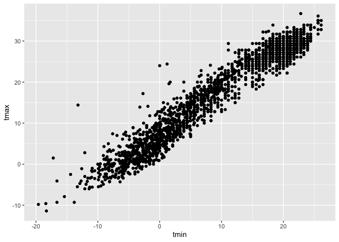
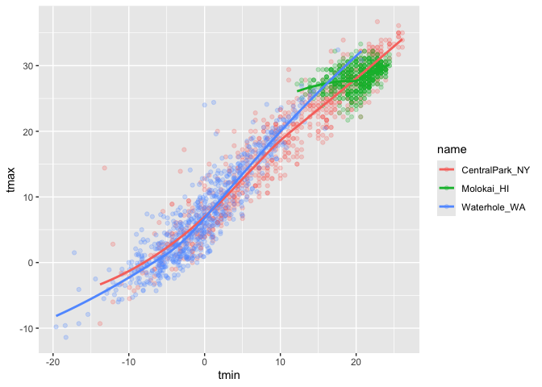
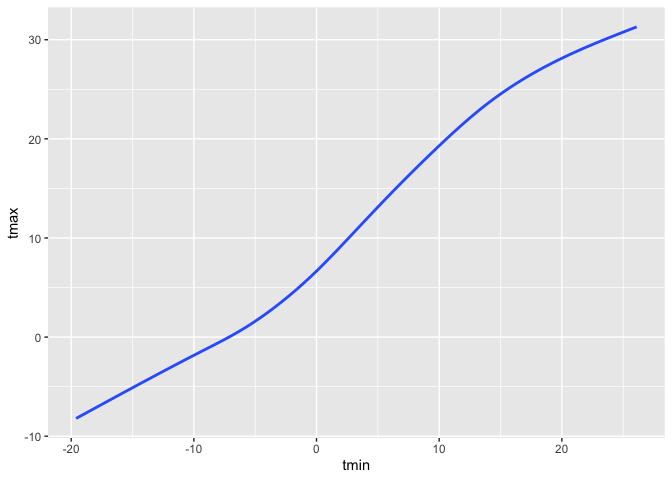
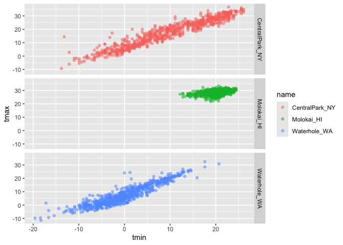
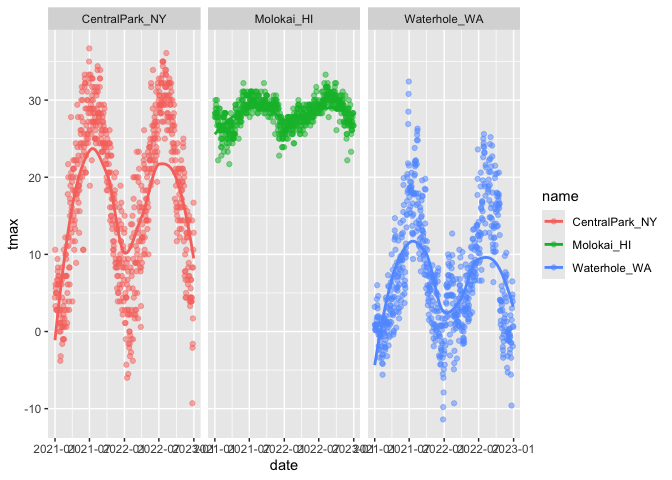
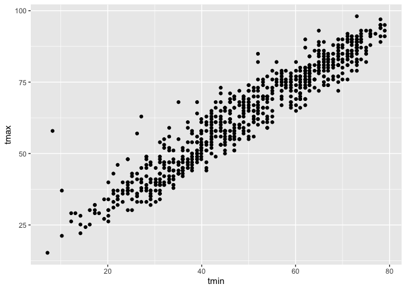

01_Viz
================
Sania Sheifuddin
2026-10-01

``` r
library (tidyverse)
```

    ## ── Attaching core tidyverse packages ──────────────────────── tidyverse 2.0.0 ──
    ## ✔ dplyr     1.2.1     ✔ readr     2.2.0
    ## ✔ forcats   1.0.1     ✔ stringr   1.6.0
    ## ✔ ggplot2   4.0.3     ✔ tibble    3.3.1
    ## ✔ lubridate 1.9.5     ✔ tidyr     1.3.2
    ## ✔ purrr     1.2.2     
    ## ── Conflicts ────────────────────────────────────────── tidyverse_conflicts() ──
    ## ✖ dplyr::filter() masks stats::filter()
    ## ✖ dplyr::lag()    masks stats::lag()
    ## ℹ Use the conflicted package (<http://conflicted.r-lib.org/>) to force all conflicts to become errors

``` r
library (ggridges)

library (p8105.datasets)
data ("weather_df")
```

``` r
weather_df
```

    ## # A tibble: 2,190 × 6
    ##    name           id          date        prcp  tmax  tmin
    ##    <chr>          <chr>       <date>     <dbl> <dbl> <dbl>
    ##  1 CentralPark_NY USW00094728 2021-01-01   157   4.4   0.6
    ##  2 CentralPark_NY USW00094728 2021-01-02    13  10.6   2.2
    ##  3 CentralPark_NY USW00094728 2021-01-03    56   3.3   1.1
    ##  4 CentralPark_NY USW00094728 2021-01-04     5   6.1   1.7
    ##  5 CentralPark_NY USW00094728 2021-01-05     0   5.6   2.2
    ##  6 CentralPark_NY USW00094728 2021-01-06     0   5     1.1
    ##  7 CentralPark_NY USW00094728 2021-01-07     0   5    -1  
    ##  8 CentralPark_NY USW00094728 2021-01-08     0   2.8  -2.7
    ##  9 CentralPark_NY USW00094728 2021-01-09     0   2.8  -4.3
    ## 10 CentralPark_NY USW00094728 2021-01-10     0   5    -1.6
    ## # ℹ 2,180 more rows

Let’s make a scatterplot

``` r
ggplot(weather_df,aes(x=tmin, y = tmax))
```

<!-- -->

``` r
# if we only run that we have not completely written down what we need and what kind of plot am I interested in?
```

``` r
ggplot(weather_df,aes(x=tmin, y = tmax)) +
  geom_point()
```

    ## Warning: Removed 17 rows containing missing values or values outside the scale range
    ## (`geom_point()`).

<!-- -->

``` r
ggp_temp_scatterplot = 
weather_df |>
  ggplot(aes (x=tmin, y= tmax)) +
  geom_point()

ggp_temp_scatterplot
```

    ## Warning: Removed 17 rows containing missing values or values outside the scale range
    ## (`geom_point()`).

<!-- -->

Let’s make this a bit fancier…

``` r
weather_df |>
  ggplot(aes (x=tmin, y= tmax, color = name)) +
  geom_point(alpha = .25) +
  geom_smooth (se=FALSE)
```

    ## `geom_smooth()` using method = 'loess' and formula = 'y ~ x'

    ## Warning: Removed 17 rows containing non-finite outside the scale range
    ## (`stat_smooth()`).

    ## Warning: Removed 17 rows containing missing values or values outside the scale range
    ## (`geom_point()`).

<!-- -->

``` r
# gives a smooth curve in the middle for all categories 
```

``` r
weather_df |>
  ggplot(aes (x=tmin, y= tmax)) + #if we run this it's gonna run a blank plot cuz we haven't told what data it needs
  geom_smooth (se=FALSE)
```

    ## `geom_smooth()` using method = 'gam' and formula = 'y ~ s(x, bs = "cs")'

    ## Warning: Removed 17 rows containing non-finite outside the scale range
    ## (`stat_smooth()`).

<!-- -->

``` r
# you don't have a scatterplot, once you tell you dataset what to do it will create something from datapoints 
```

Show faceting

``` r
weather_df |>
  ggplot(aes(x=tmin, y=tmax, color = name))+
geom_point(alpha = .5)+
  facet_grid(.~name) # when you want name to separate to columns, variable name will separate the columns 
```

    ## Warning: Removed 17 rows containing missing values or values outside the scale range
    ## (`geom_point()`).

<!-- -->

``` r
weather_df |>
  ggplot(aes(x=tmin, y=tmax, color = name))+
geom_point(alpha = .5)+
   facet_grid(name~.) #This would give a horizontal version of the last one
```

    ## Warning: Removed 17 rows containing missing values or values outside the scale range
    ## (`geom_point()`).

<!-- -->

``` r
weather_df |>
  ggplot(aes(x=tmin, y=tmax, color = name))+
geom_point(alpha = .5)+
   facet_grid(cols=vars(name))
```

    ## Warning: Removed 17 rows containing missing values or values outside the scale range
    ## (`geom_point()`).

<!-- --> Let’s look
at something else

``` r
weather_df |>
  ggplot(aes(x= date, y=tmax,color =name)) +
geom_point(alpha=0.5) + 
  geom_smooth(se=FALSE)+
  facet_grid (.~name)
```

    ## `geom_smooth()` using method = 'loess' and formula = 'y ~ x'

    ## Warning: Removed 17 rows containing non-finite outside the scale range
    ## (`stat_smooth()`).

    ## Warning: Removed 17 rows containing missing values or values outside the scale range
    ## (`geom_point()`).

<!-- --> Make a plot
of central park tmax v tmin only, and convert temperatures to farenheit.

``` r
weather_df |>
  filter (name == "CentralPark_NY") |>
  mutate (
    tmax = tmax * (9/5) + 32,
    tmin = tmin * (9/5) + 32
  ) |>
  ggplot(aes(x= tmin, y=tmax)) +
  geom_point() 
```

<!-- -->
